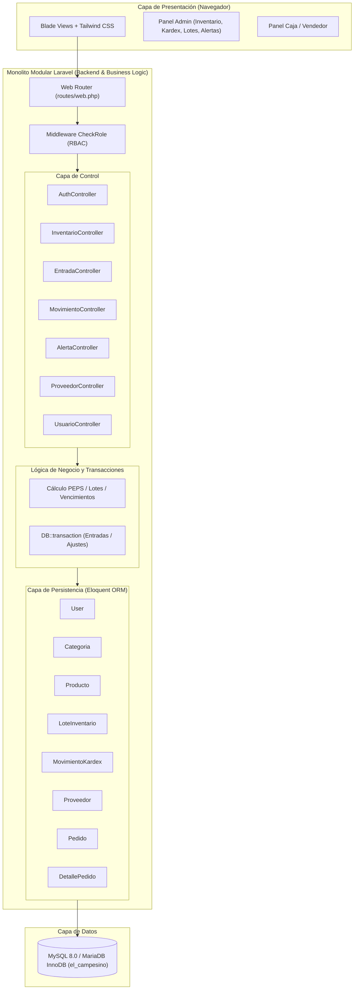
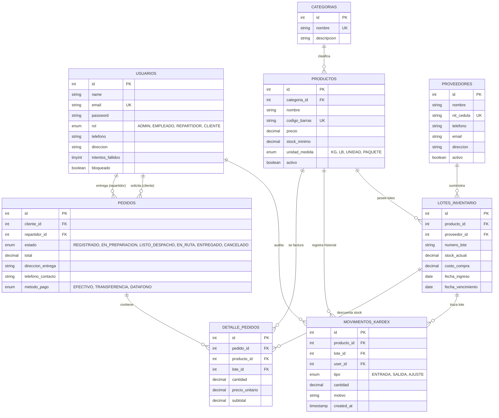

# Documentación Técnica y Arquitectónica — El Campesino MiniMarket
**Seminario Integrador / Ingeniería de Software II — Periodo 2026-02**  
*Institución Universitaria Antonio José Camacho — Facultad de Ingeniería*  
*Equipo:* Juan Sebastián Muñoz Calderón, Luisa Fernanda Cabezas, Julián David Chavarría, Mariana Muñoz Latorre  

---

## 1. Diagnóstico del Estado Previo y Saneamiento

Antes de la intervención arquitectónica, el repositorio presentaba un desfase crítico entre el diseño conceptual y el código ejecutable:

1. **Vistas estáticas desacopladas:** Las rutas en `routes/web.php` respondían únicamente mediante `Route::view()`. Las pantallas administrativas mostraban números y tablas quemadas en código HTML estático sin consumir modelos ni controladores.
2. **Sabotaje en migraciones:** La migración central de usuarios se encontraba inhabilitada bajo el nombre `0001_01_01_000000_create_users_table.php.bak`, impidiendo la ejecución de `php artisan migrate`.
3. **Desconexión entre SQL y Eloquent:** Existía un script aislado (`schema.sql`), pero no habían sido construidas las migraciones en Laravel ni los modelos relacionales de Eloquent.
4. **Archivos residuales ajenos:** Se detectó y eliminó una carpeta `output/` con datos de seguimiento DMCA que correspondían a otro proyecto.
5. **Ausencia de autenticación funcional:** No existía validación de contraseñas bajo hashing, gestión de sesiones, ni el bloqueo por 3 intentos fallidos exigido en los requerimientos del Módulo 1.

---

## 2. Definición Arquitectónica

El sistema adopta una **Arquitectura Monolítica Modular basada en el Patrón MVC (Modelo - Vista - Controlador) con Renderizado del Lado del Servidor (SSR)**.

### Justificación Técnica de la Arquitectura
* **Monolítica:** La interfaz web, la lógica comercial de inventario y el acceso a datos residen en la misma unidad desplegable. Elimina latencias de red internas, problemas de CORS y la complejidad de coordinar microservicios innecesarios para el tamaño operativo del minimarket.
* **Modular:** Cada módulo funcional (Inventario, Kardex, Proveedores, Usuarios, Alertas) cuenta con controladores, modelos y vistas independientes, permitiendo mantenimiento granular.
* **Transaccionalidad ACID:** Operaciones críticas como el ingreso de mercancía (creación de lote + generación de movimiento Kardex + actualización de stock) se ejecutan bajo `DB::transaction` garantizando integridad absoluta en MariaDB/MySQL.

---

## 3. Modelo de Datos Relacional Implementado

Se implementaron 8 migraciones versionadas y sus respectivos modelos Eloquent:

---

## 4. Módulos Funcionales Construidos

| Módulo | Componentes | Funcionalidad Implementada |
| :--- | :--- | :--- |
| **M1: Autenticación y Seguridad** | `AuthController`, `CheckRole`, `login.blade.php` | Login con credenciales cifradas con `Hash::make()`, protección de rutas por roles (`ADMIN`, `EMPLEADO`), bloqueo automático tras 3 intentos fallidos y cierre de sesión seguro. |
| **M2: Inventario** | `InventarioController`, `inventario.blade.php`, `Producto.php` | Catálogo interactivo, cálculo en vivo de existencias acumuladas de todos los lotes, búsqueda por nombre o código de barras, filtro por categoría, altas y bajas lógicas. |
| **M3: Entradas de Mercancía** | `EntradaController`, `entradas.blade.php`, `LoteInventario.php` | Recepción de insumos asignados a un proveedor, cálculo de costo unitario, fecha de ingreso y caducidad, creación atómica del lote y del asiento en Kardex. |
| **M4: Kardex y Movimientos** | `MovimientoController`, `movimientos.blade.php`, `MovimientoKardex.php` | Histórico general de entradas, salidas y ajustes manuales. Permite ingresar mermas y descomposiciones físicas con justificación y auditoría de usuario. |
| **M5: Centro de Alertas** | `AlertaController`, `alertas.blade.php` | Detección automática en tiempo real de lotes vencidos, lotes críticos (≤ 7 días), lotes próximos (≤ 30 días) y productos con existencias por debajo del stock mínimo. |
| **M6: Proveedores** | `ProveedorController`, `proveedores.blade.php`, `Proveedor.php` | Directorio de empresas aliadas con NIT, datos de contacto, dirección y conteo dinámico de lotes suministrados. |
| **M7: Usuarios y Personal** | `UsuarioController`, `usuarios.blade.php`, `User.php` | Administración de cuentas de empleados, asignación de roles, reinicio de intentos fallidos y botón de bloqueo / desbloqueo. |
| **Punto de Venta / Caja** | `Vendedor\DashboardController`, `vendedor/dashboard.blade.php` | Interfaz limpia para personal de caja que permite consultar disponibilidad y precios en tiempo real sin acceso a configuraciones críticas de administración. |

---

## 5. Datos Semilla Cargados para Sustentación

Se diseñó `DatabaseSeeder.php` con datos representativos del mercado local de Cali:

* **Categorías:** Pollos y Aves, Carnes Rojas, Abarrotes y Granos, Lácteos y Huevos.
* **Proveedores:** Avícola La Colina S.A.S (Candelaria), Frigorífico del Valle (Yumbo), Distribuidora Central Cavasa.
* **Productos y Lotes:** Incluye productos en estado óptimo, un lote de pechuga con fecha crítica de caducidad (4 días), queso artesanal a vencer en 6 días y pollo entero en stock cero para verificar las alarmas visuales en el panel de control.

### Usuarios Preconfigurados para Pruebas:
* **Administrador:** `admin@campesino.com` / `admin123`
* **Cajero / Empleado:** `cajero@campesino.com` / `cajero123`
* **Repartidor:** `carlos@campesino.com` / `repartidor123`
* **Cliente:** `mariana@gmail.com` / `cliente123`
